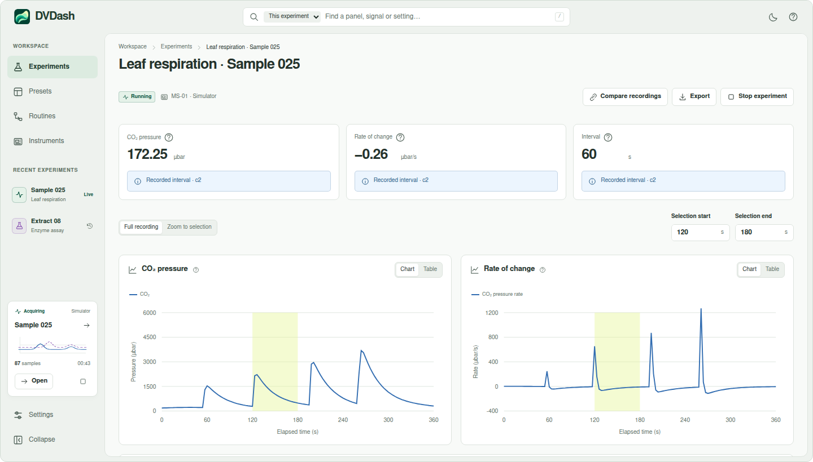

<p align="center" class="brand-icon">
  
</p>

<h1 align="center">DVDash</h1>

<p align="center">A modular workspace for scientific instruments, data, and analysis.</p>

<p align="center" class="badges">
  <a href="LICENSE.txt"></a>
  <a href="https://ddelvalfraire.github.io/cousins-lab-tools/"></a>
  <a href="https://github.com/ddelvalfraire/cousins-lab-tools/releases"></a>
  <a href="https://app.circleci.com/pipelines/circleci/MkkpKyoh5KZcRqbZnqUuPM/QiTPgqsziZ6UeBALmEUhw"></a>
</p>

<p align="center">
  <a href="#start-here">Start here</a> ·
  <a href="#a-look-at-the-workspace">Workspace</a> ·
  <a href="#run-locally">Run locally</a> ·
  <a href="#project-map">Project map</a>
</p>

DVDash is a scientific desktop application being developed for the **WSU Cousins Plant Biology Lab**. It brings instrument data, visualization, and analysis into a modular workspace designed to grow with the lab's experiments. The existing mass-spectrometer tools support plant respiration research; the new application aims to bring those workflows and additional instruments into one extensible platform.

## Start here

<table width="100%">
  <thead>
    <tr><th scope="col" align="left" width="400">I want to…</th><th scope="col" align="left" width="1000">Go to</th></tr>
  </thead>
  <tbody>
    <tr><td>Get the existing Windows applications</td><td><a href="https://github.com/ddelvalfraire/cousins-lab-tools/releases/tag/legacy-v0.2.0-rc.2">Module 1 and 2 downloads · release candidate</a></td></tr>
    <tr><td>Learn the lab workflow</td><td><a href="https://ddelvalfraire.github.io/cousins-lab-tools/">Researcher user manual</a></td></tr>
    <tr><td>Try a sample recording</td><td><a href="reference/instruments/mass-spec/README.md">Example datasets</a></td></tr>
    <tr><td>Run the Python tools from source</td><td><a href="apps/legacy/README.md">Legacy setup and launch guide</a></td></tr>
    <tr><td>Develop the native desktop app</td><td><a href="apps/desktop/README.md">Desktop setup</a></td></tr>
    <tr><td>Read project reports and history</td><td><a href="documentation/">Project archive</a></td></tr>
  </tbody>
</table>

## A look at the workspace



*Current experiment-workspace design with illustrative data. Instrument workflows are still under development in DVDash.*

## Run locally

### Run the Python tools

[Python setup and launch commands →](apps/legacy/README.md)

### Develop DVDash

Install the prerequisites in the [desktop setup guide](apps/desktop/README.md), then run from the repository root:

```sh
cd apps/desktop
bun install --frozen-lockfile
bun run tauri dev
```

See the [desktop guide](apps/desktop/README.md) for builds and cleanup.

## Project map

```text
apps/
  desktop/       Desktop application in development
  legacy/        Python instrument tools and regression checks
design/          Visual studies and local design reviews
documentation/  Project requirements, reports, manual tests, and history
reference/      Reference material
```

### Module 2: Ambit acquisition

Install Module 2's requirements, then open **File > Ambit acquisition**.
Choose or type the Ambit serial port and, for external LED commands, the
separate pulser serial port. Load a JSON protocol, enter the measured signal
offset, and select a new CSV file outside the mass-spectrometer acquisition
folder. Stop cancels the protocol and attempts to turn off both lights and stop
the instrument.

The protocol format follows the notebook's command lists. For example:

```json
[
  ["M", 10, 0.1, 0],
  ["W", 1],
  ["P"]
]
```

Notebook examples are in `apps/legacy/Code/Module_Main_1_3/Application/protocols/`.
In **Load protocol**, browse to that folder and select
`signal_offset_protocol.json`: it requests 50 zero-actinic measurements at
0.1-second intervals. To calculate an offset, select **Calculate offset from
baseline CSV**, choose a baseline run, and review its mean `S` before applying
it. The application cannot determine whether the selected file follows your
lab's baseline procedure.

The `reference_only` subfolder contains the notebook's other examples,
including the expanded `Protocol_1`, `Protocol_2`, and `Protocol_5`. They are
preserved for reference, not approved for hardware use. If loading fails, the
previously selected protocol remains selected; check the displayed filename
before starting. The notebook's duplicated saturation-flash definitions are
represented by one file per distinct version.

`M` specifies count, interval in seconds, and Ambit actinic intensity; `W`
waits in seconds. By default, the plot updates continuously and `P` does not
change it. **Update graph only at P steps** instead shows data accumulated
up to each `P`; if there is no `P`, the graph stays empty, including after
the run. This controls display updates only: unlike the notebook, it does not
pause acquisition to wait for the graph to render, so timing can differ.
`["A", "B", intensity]` and `["A", "R", intensity]` control the external
blue and red LEDs (0 turns a channel off). The Ambit actinic setting remains
on until another `M` step changes it or cleanup requests shutdown.
The protocol preview shows each step, commanded light settings, and estimated
duration before running. Timing excludes communication and other delays.

Like the notebook, Module 2 does not enforce exposure-duration limits. External
LED values must be integers from 0 to 4094, matching the notebook's DAC check;
the built-in Ambit accepts 0-255. The notebook warns that external LEDs should
not be left on for long periods and lists suggested exposure durations. Verify
safe intensities, durations, and cooldowns with the instrument owner before
running a protocol; the reference examples are not hardware safety guidance.

Shutdown requests are **not a hardware cutoff**. Timing, serial operations,
system stalls, disconnects, and shutdown failures can delay or prevent switching
a light off. Verify physical shutdown; do not assume measurement pulses or
independently operated lights are disabled.

Each Ambit row is saved immediately with its raw response, instrument time,
host UTC receipt time, offset, calculated `(S - offset) / R`, and commanded
Ambit (`ACT`), blue (`Blue`), and red (`Red`) light settings. These are
commanded settings, not measured light output. If the run does not use a
pulser, blue and red settings are unknown and their CSV fields are blank.
Select **Show uncorrected S / R** to add the uncorrected ratio to the graph.

An accompanying `<CSV filename>.metadata.json` records the exact protocol,
offset, ports, output and plot options, and host UTC time when the run is
initiated, before connection.
Keep this file with its CSV. Both names must be new; errors while creating
files or connecting can leave an empty or header-only CSV or metadata file.
With **Save notebook-compatible CSV** selected, a separate
`<CSV filename>.notebook.csv` is created after device cleanup, including for
stopped or failed runs. It follows the notebook's raw numeric fields and
`ACT`, `Blue`, and `Red` columns, including additional numeric fields found
in later readings. Unknown blue and red settings remain blank rather than
being assumed to be zero. The notebook CSV name must also be new. A sudden
process termination may leave this file empty; the detailed CSV is flushed
throughout acquisition. Export errors are reported.

A zero reference is saved as raw data and stops the run with an error. Preserve the
mass-spectrometer's original timestamped acquisition/spool data separately:
Module 2's plotted mass data uses relative time, and this feature does not
synchronize the instruments. The UTC receipt time is not a hardware trigger
timestamp. Existing files are not overwritten.


## Contributing

Choose the relevant app guide above before changing code. Use the [desktop development guide](apps/desktop/README.md) for DVDash and the [legacy regression check](apps/legacy/README.md#regression-check) for the Python tools.

Keep scientific units explicit, preserve original samples when changing display settings, and identify fixture behavior clearly. Submit changes with a description of the behavior and how it was verified.

## Credits and license

Developed for the **WSU Cousins Plant Biology Lab** by successive WSU student teams.

<table width="100%">
  <thead>
    <tr><th scope="col" align="left" width="100">Year</th><th scope="col" align="left" width="180">Team</th><th scope="col" align="left" width="1000">Members</th></tr>
  </thead>
  <tbody>
    <tr><th scope="row" align="left">2026&#8288;–&#8288;27</th><td>PhotosynthLab</td><td><a href="https://github.com/ddelvalfraire">David Del Val</a> · <a href="https://github.com/Inventor4life">Ethan Goode</a> · <a href="https://github.com/MaxUpton">Max Upton</a></td></tr>
    <tr><th scope="row" align="left">2025&#8288;–&#8288;26</th><td>WM Codeworks</td><td>Matthew Heseltine · <a href="https://github.com/SkywalkerWesley">Wesley Skywalker</a></td></tr>
    <tr><th scope="row" align="left">2024&#8288;–&#8288;25</th><td>Linnaea Borealis</td><td><a href="https://github.com/KylerKupp">Kyler Kupp</a> · <a href="https://github.com/MetzgerH">Erik Holtrop</a></td></tr>
    <tr><th scope="row" align="left">2023&#8288;–&#8288;24</th><td>Dracaena</td><td>Brayden Groshong · Jack Leeper · Tomer Zangi</td></tr>
    <tr><th scope="row" align="left">2022&#8288;–&#8288;23</th><td>Data Pirates</td><td>Ritik Agarwal · Zoe Parker</td></tr>
  </tbody>
</table>

With thanks to **Dr. Asaph Cousins**, the **Cousins lab research team**, and project mentor **Parteek Kumar** for their guidance and feedback.

<p align="center">
  <a href="https://github.com/ddelvalfraire/cousins-lab-tools/graphs/contributors">
    <br>
    <sub>GitHub contributor history</sub>
  </a>
</p>

<p align="center">
  <a href="LICENSE.txt">MIT License</a> ·
  <a href="https://github.com/ddelvalfraire/cousins-lab-tools/graphs/contributors">Contributor history</a> ·
  <a href="documentation/">Project archive</a>
  · <a href="https://github.com/ddelvalfraire/cousins-lab-tools/issues/new/choose">Report a problem</a>
  · <a href="CITATION.cff">Cite this software</a>
</p>
