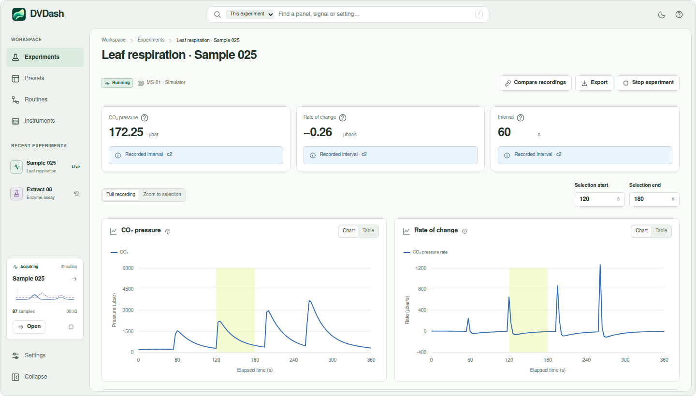

<p align="center" class="brand-icon">
  
</p>

<h1 align="center">DVDash</h1>

<p align="center">A modular workspace for scientific instruments, data, and analysis.</p>

<p align="center" class="badges">
  <a href="LICENSE.txt"></a>
  <a href="https://ddelvalfraire.github.io/cousins-lab-tools/"></a>
  <a href="https://github.com/ddelvalfraire/cousins-lab-tools/releases/tag/legacy-v0.2.0-rc.2"></a>
  <a href="https://app.circleci.com/pipelines/circleci/MkkpKyoh5KZcRqbZnqUuPM/QiTPgqsziZ6UeBALmEUhw"></a>
</p>

<p align="center">
  <a href="#start-here">Start here</a> ·
  <a href="#a-look-at-the-workspace">Workspace</a> ·
  <a href="#run-locally">Run locally</a> ·
  <a href="#project-map">Project map</a>
</p>

DVDash is a scientific desktop application being developed for the **WSU Cousins Plant Biology Lab**. It brings instrument data, visualization, and analysis into a modular workspace designed to grow with the lab's experiments. The existing mass-spectrometer tools support plant respiration research; the new application aims to bring those workflows and additional instruments into one extensible platform.

## Start here

| I want to… | Go to |
| --- | --- |
| Get the existing Windows applications | [Module 1 and 2 downloads · release candidate](https://github.com/ddelvalfraire/cousins-lab-tools/releases/tag/legacy-v0.2.0-rc.2) |
| Learn the lab workflow | [Researcher user manual](https://ddelvalfraire.github.io/cousins-lab-tools/) |
| Try a sample recording | [Example datasets](reference/instruments/mass-spec/README.md) |
| Run the Python tools from source | [Legacy setup and launch guide](apps/legacy/README.md) |
| Develop the native desktop app | [Desktop setup](apps/desktop/README.md) |
| Read project reports and history | [Project archive](documentation/) |

## A look at the workspace



*Current experiment-workspace design with illustrative data. Instrument workflows are still under development in DVDash.*

## Run locally

### Run the Python tools

[Python setup and launch commands →](apps/legacy/README.md)

### Develop DVDash

Install the prerequisites in the [desktop setup guide](apps/desktop/README.md), then run from the repository root:

```sh
cd apps/desktop
bun install --frozen-lockfile
bun run tauri dev
```

See the [desktop guide](apps/desktop/README.md) for builds and cleanup.

## Project map

```text
apps/
  desktop/       Desktop application in development
  legacy/        Python instrument tools and regression checks
design/          Visual studies and local design reviews
documentation/  Project requirements, reports, and history
reference/      Reference material
```

## Contributing

Choose the relevant app guide above before changing code. Use the [desktop development guide](apps/desktop/README.md) for DVDash and the [legacy regression check](apps/legacy/README.md#regression-check) for the Python tools.

Keep scientific units explicit, preserve original samples when changing display settings, and identify fixture behavior clearly. Submit changes with a description of the behavior and how it was verified.

## Credits and license

Developed for the **WSU Cousins Plant Biology Lab** by successive WSU student teams.

<p align="center">
  <a href="https://github.com/ddelvalfraire/cousins-lab-tools/graphs/contributors">
    
  </a>
</p>

**Additional contributors**

- **2025–26:** Matthew Heseltine and [Wesley Skywalker](https://github.com/SkywalkerWesley)
- **2023–24:** Brayden Groshong, Jack Leeper, and Tomer Zangi
- **2022–23:** Ritik Agarwal and Zoe Parker

With thanks to **Dr. Asaph Cousins**, the **Cousins lab research team**, and project mentor **Parteek Kumar** for their guidance and feedback.

<p align="center">
  <a href="LICENSE.txt">MIT License</a> ·
  <a href="https://github.com/ddelvalfraire/cousins-lab-tools/graphs/contributors">Contributor history</a> ·
  <a href="documentation/">Project archive</a>
  · <a href="https://github.com/ddelvalfraire/cousins-lab-tools/issues/new/choose">Report a problem</a>
  · <a href="CITATION.cff">Cite this software</a>
</p>
