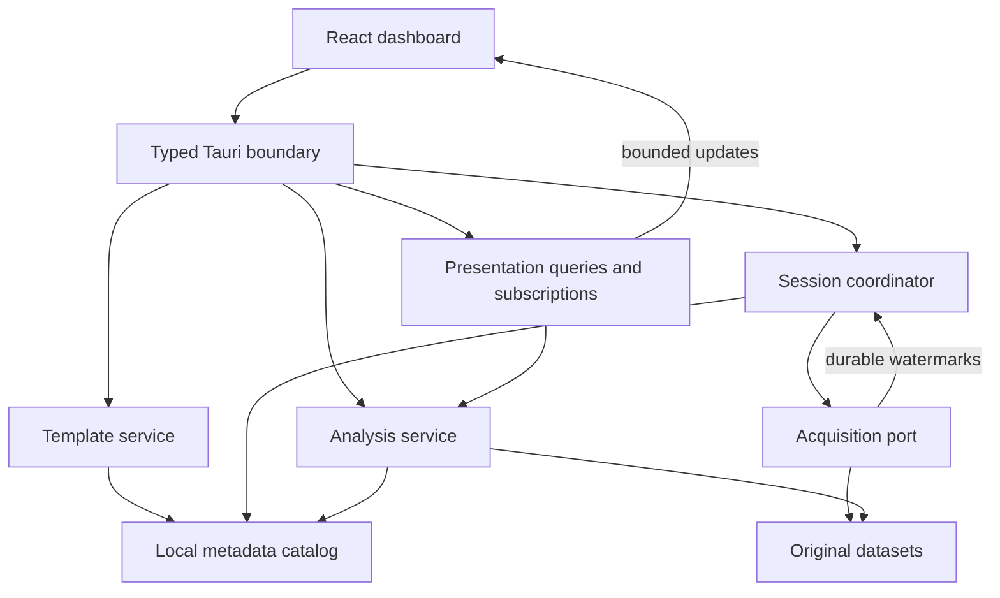

# Template dashboard architecture proposal

Status: proposed. No production types, schemas, storage migrations, or services are implemented by this document. D04 requires explicit user/team approval.

## Caller workflow

A developer submits a typed TemplateDocument over IPC. The template service validates the document and publishes an immutable revision. A researcher selects a saved revision, binds its logical roles to compatible local sources, and starts a session or opens recorded data.

The session stores a complete definition and source-schema snapshot. The renderer receives a validated screen model. Components reference stable series, parameters, step and measurement IDs. They never know whether the underlying dataset arrived from hardware, replay, simulation, or import.

A parameter change creates an analysis context. The analysis service recomputes dependent display data. A separate acquisition port owns source configuration, physical commands and raw records.

## Ownership

These are modules within one desktop application, not proposed network microservices.

| Owner | Responsibility | Sole writes |
| --- | --- | --- |
| Template service | Validate definitions, resolve dependencies, publish revisions, import/export, compare versions | Template catalog and immutable revision records |
| Session coordinator | Pin definitions, bind roles, serialize group decisions, track requested/effective operations | Session state and operation journal |
| Acquisition service port | Describe sources, ingest original records, execute capability-checked operations, publish durable data watermarks | Raw datasets and capture/source state |
| Analysis service | Resolve parameters, calibration, selection statistics and derived series; freeze results | Analysis contexts, observations and measurement records |
| Presentation query service | Produce bounded charts, tables, screen state and update notifications from pinned context | Disposable query caches/subscriptions |
| React frontend | Render approved component variants, collect intent, preserve local presentation preferences | View-local selection, visibility, zoom and appearance overrides |

The acquisition service may be an injected in-process implementation initially. Its transport is not part of the dashboard contract. Do not add a process boundary without an integration requirement.

The UI cannot modify original samples, call a serial port, issue arbitrary SQL, or infer that command acceptance changed an instrument.

## Ownership diagram

## Domain models

Use separate IDs for templates, revisions, sessions, captures, datasets, signals, components, operations and analysis contexts. Definitions are typed variants rather than arbitrary JSON maps inside the domain.

| Model | Identity and required content |
| --- | --- |
| TemplateDocument | schema_version, name/description, logical source requirements, parameters, calculations, calibration/measurement specifications, protocols, operational groups, charts and layout |
| TemplateRevision | revision_id, template_id, ordinal, parent_revision_id, canonical document, content_hash, created_at, change summary and optional imported origin |
| SourceDescriptor | source kind, stable signals with types/units, clocks with their meaning/scale, supported operations and timing-adjustment bounds |
| SourceBinding | logical role to a local source instance; lives in session configuration, not a shared template's machine paths |
| SessionSnapshot | complete template document/hash, selected revision, renderer schema version, source descriptors/bindings and acquisition configuration |
| DatasetWatermark | dataset_id plus durable position; no promise that this equals the last pixel drawn |
| AnalysisContext | Immutable analysis_id/revision, session, analysis-record checkpoint, parameter values/provenance, calibration records and alignment/selection policy |
| EvaluationSnapshot | evaluation_id, analysis_id and exact committed watermarks for every input dataset; immutable across later appends |
| Measurement | immutable result snapshot, label, units, evaluation_id, exact input ranges/watermarks and analysis/calibration references |
| Operation | operation_id and idempotency key, target, request payload, lifecycle status, requested/effective times and failure/refusal details |
| ViewPreferences | installation-local appearance and visibility keyed by revision/component; no change to saved experimental meaning |

A layout contains named views. Each view contains discriminated components: chart, metric, inputs, readings, table, controls, captures, or group. Visual groups contain components; operational groups reference source roles. Moving a chart must not change which instruments start together.

Charts declare typed data bindings, time or XY axes and units. Time-series bindings use signal/calculation references. XY bindings also support paired calibration observations, fitted calibration curves, and committed measurement fields. Each x/y pair shares an observation or row ID. Duplicate x values remain separate points; x is never row identity. Retraction hides a row in the active view without deleting its provenance. Charts do not embed a second calculation engine.

## Dependency and calculation rules

Compile a directed acyclic graph from parameters, transformations, derived series, calibration outputs and measurement definitions. Reject missing references and cycles at publication/import. Distinguish row expressions from window operations and interval statistics.

Use a constrained expression grammar and named approved operations. Import cannot provide JavaScript, native plugins, filesystem access, network access, or executable SQL. A chart references a compiled expression ID. Rust owns evaluation for live display, recorded display, extraction and export.

Units, nullability, numeric invalidity and clock domains are explicit. An unset parameter, division by zero, unavailable signal, or derivative warm-up produces a typed unavailable result with an explanation, not a fabricated zero. Validate dimensional operations where supported and reject operations whose unit rule is undefined.

Keep original records separate from the legacy per-file mean reduction. Name and version the reduction so replay batching never changes scientific meaning. Source analysis shows that a legacy plotted point is already an aggregate. [FRAME](https://github.com/ddelvalfraire/cousins-lab-tools/blob/9d6a7ef682c9a323170b107d54cdc2c18de0c6a8/apps/legacy/module1/application/read-data/file.py#L16-L43)

## Local persistence recommendation

Use one SQLite catalog for the application-owned metadata below. Use short transactions and one application-owned writer. SQLite serializes writers, so keep high-volume raw samples out of these control transactions. [SQLite isolation documentation](https://www.sqlite.org/isolation.html)

| Table | Key and important constraints | Dominant access pattern |
| --- | --- | --- |
| templates | template_id PK, current_revision_id FK, archived flag | Keyset page by name/ID and load current head |
| template_revisions | revision_id PK; UNIQUE(template_id, ordinal); parent FK; canonical document/hash | Exact revision lookup and keyset history by template/ordinal |
| import_origins | origin identity/hash with UNIQUE constraint and local revision FK | Idempotent imports and explicit forks |
| sessions | session_id PK, state, complete snapshot, snapshot hash, renderer version | Reopen exact session; keyset list by created_at/session_id |
| captures | capture_id PK, session FK, role, dataset reference, source schema, durable watermark | Resolve role to immutable data and track committed positions |
| analysis_contexts | analysis_id PK, session FK, monotonic revision, complete configuration/hash | Exact analysis configuration and compare expected revision |
| evaluation_snapshots | evaluation_id PK, analysis FK, immutable dataset watermarks/hash | Reproduce a display, interval extraction or measurement over identical inputs |
| analysis_records | record_id PK, session/sequence UNIQUE, request_id UNIQUE within session | Append action and replay/page actions in order |
| measurements | measurement_id PK, session/measurement ordinal, frozen values/provenance | Page results and export a chosen consistent snapshot |
| operations | operation_id PK, request_id UNIQUE, target/payload hash/status | Retry safely and distinguish accepted from applied |
| change_log | session/sequence UNIQUE, typed metadata change and related watermark | Resume dashboard state notifications and establish snapshot boundaries |
| view_preferences | revision/component key and preference schema version | Restore presentation overrides without revising a template |

Each publication atomically checks expected_head_revision, inserts the new revision, and updates the head. A request retry with the same key and payload returns its original result. Reusing a key with different content is an error. Concurrent saves return revision_conflict rather than silently publishing from stale assumptions.

Changing an old revision creates a new descendant. Restore copies an earlier definition into a new revision with restore provenance. Existing revisions remain unchanged. A hash proves content identity, not trust or scientific correctness.

The acquisition service owns raw storage and recovery. Prototype Parquet segments are a reuse candidate, not a format mandate for this epic. Catalog transactions must not claim atomicity across a database and external sample files. Persist pending state, let acquisition publish data atomically, then reconcile its durable watermark. Read/export only committed segments. Test each crash boundary.

If using SQLite WAL, choose and document durability, checkpoint and backup policies in P01. A template export is not a database backup. Do not keep the catalog on a shared network folder.

## Workflows

### Publish or import

Validate at the boundary -> compile references and requirements -> compare expected head/import identity -> commit immutable revision -> return diagnostics/screen model.

A portable import is inert. It never starts acquisition or resolves a sender's machine paths. New imported identities create local templates. Identical origin/content imports reuse existing records. Divergent content requires an explicit fork or a verified parent lineage, never overwrite by filename.

### Open or start a session

Load the selected revision -> resolve compatible sources -> validate operation capabilities -> persist the complete session snapshot -> coordinate acquisition or bind recorded datasets -> subscribe/render the snapshot.

Session rendering uses its own saved definition, not TemplateStore.get against today's library. The prototype stores a full snapshot but its capture page still fetches the library revision. [PTPIN](https://github.com/ddelvalfraire/cousins-lab-tools/blob/722daeeb5fc32f664d86fd2fbf94833a5421e29b/prototype/core/src/templates.rs#L847-L850) [PUI](https://github.com/ddelvalfraire/cousins-lab-tools/blob/722daeeb5fc32f664d86fd2fbf94833a5421e29b/prototype/acquisition-ui/capture.js#L164-L240)

### Recalculate

Validate parameter action against the session snapshot -> append action and publish an immutable analysis configuration -> pin an immutable evaluation snapshot with exact input watermarks -> compute -> publish results tagged with analysis_id and evaluation_id -> update linked widgets together.

Proposal pending O2: changed calibration recomputes displayed history. Committed measurement rows keep their original context. A correction creates a new result record or explicit retraction/replacement. Preview never changes a device setting.

A running session may receive new data during recomputation. When a view follows a later append, the service creates a new EvaluationSnapshot under the same AnalysisContext, not a mutation of the old snapshot. The frontend discards superseded evaluations and applies one consistent evaluation per view. Interval reads, measurement commits and calculated exports name evaluation_id explicitly. A measurement committed after a new append still uses its selected snapshot; adopting newer inputs requires another evaluation. Parameter changes and recorded analysis actions instead create a new AnalysisContext. Its analysis-record checkpoint fixes which observations and measurement rows are active, so an XY query can reproduce its row set after later insertions or retractions.

### Operate a group

Request a supported operation -> record accepted intent -> acquisition owner schedules/applies it -> record effective outcome -> update controls/status.

Use monotonic scheduling for delays, retain wall/device timestamps as supplied, and never interpret simultaneous requests as physically synchronized measurement. The stop generation cancels pending starts and prevents a late completion from starting a stopped group.

### Restart

Reopen committed catalog and acquisition state -> reconcile pending metadata/segments -> mark unfinished acquisition interrupted -> render stored data and analysis. Do not auto-reissue a device command. The prototype also interrupts rather than resumes unfinished runs. [PRECOVER](https://github.com/ddelvalfraire/cousins-lab-tools/blob/722daeeb5fc32f664d86fd2fbf94833a5421e29b/prototype/core/src/session/recovery.rs#L9-L31)

## Module placement proposal

Keep the existing React app under apps/desktop and the Tauri host under apps/desktop/src-tauri. Add one domain crate under crates for the template/session/analysis contracts and service interfaces. Keep acquisition adapters in their owning crate. Add storage/transport modules only where their ownership warrants it, rather than one crate per table or command.

Generate frontend bindings from the authoritative Rust transport schema. Parse incoming data once at IPC/file/acquisition boundaries. The frontend receives typed screen and query results, not storage rows, filesystem locations, generic command strings, or unchecked domain JSON.

Exact crate names and binding/chart libraries are intentionally decisions for the architecture review and bounded spike. The existing prototype's generic api(command,args) is evidence, not the proposed production contract. [PDESKTOP](https://github.com/ddelvalfraire/cousins-lab-tools/blob/722daeeb5fc32f664d86fd2fbf94833a5421e29b/prototype/desktop/src/main.rs#L14-L29) [PAPI](https://github.com/ddelvalfraire/cousins-lab-tools/blob/722daeeb5fc32f664d86fd2fbf94833a5421e29b/prototype/core/src/api.rs#L180-L278)

## Reuse and replacement

| Reuse candidate from prototype | Required change or proof |
| --- | --- |
| Template and layout validation | Typed/versioned schema, field diagnostics, explicit capability/unit rules |
| Expression/calibration engine | Approved scientific semantics and identical live/recorded/export behavior |
| Session snapshots and analysis provenance | Render from snapshot end to end; preserve schema compatibility |
| Single-owner grouped operations | Define accepted/applied/refused outcomes and supported interval mutations |
| Segmented raw storage/recovery | Agree durability and storage ownership with acquisition service |
| Bounded chart points | Explicit notification resync, exact-range queries, limits and stale-context rejection |
| Immutable revision store | Transactional expected-head semantics, portable files and import lineage |

No product runtime was exercised for this architecture. The D03 spike is required before claiming throughput, memory limits, delivery behavior or hardware capability.
