# Sprint 1 diagrams

These diagrams describe the proposed data acquisition software.

## Use-case diagram

Researcher actions and their relationships. This view uses Mermaid flowchart notation.

[Mermaid source](diagrams/use-cases.mmd) · [SVG](diagrams/use-cases.svg) · [PNG](diagrams/use-cases.png)

## Class diagram

Sessions, instruments, captures, and recorded data.

[Mermaid source](diagrams/domain.mmd) · [SVG](diagrams/domain.svg) · [PNG](diagrams/domain.png)

## Activity diagram

Analysis steps and optional intervals. This view uses Mermaid flowchart notation.

[Mermaid source](diagrams/activity.mmd) · [SVG](diagrams/activity.svg) · [PNG](diagrams/activity.png)

